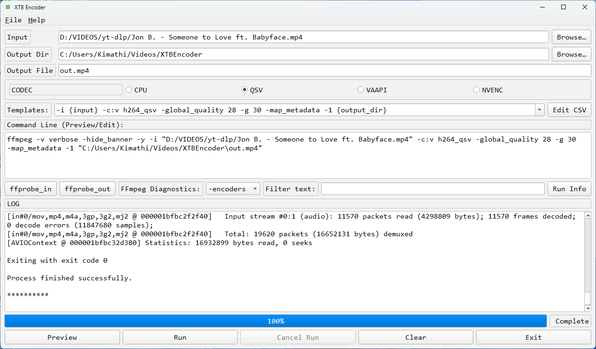

# XTB Encoder

xtbenc is a GUI for FFmpeg on Linux and Windows. It combines a graphical interface with FFmpeg's command-line options.

See the [Developer Guide](docs/DEVELOPER_GUIDE.md) for the current PySide6 architecture, workflows, and deployment details.



*Setup and packaging*

XTB Encoder uses PySide6 for its interface. Install dependencies in a virtual environment, then launch the app:

```sh
Package                   Version
------------------------- ----------
altgraph                  0.17.5
Nuitka                    4.3.4
packaging                 26.3
patchelf                  0.19.1.0
pip                       26.2.2
psgdnd                    6.0.6
pyinstaller               6.22.3
pyinstaller-hooks-contrib 2026.7
PySide6                   6.12.0
PySide6_Addons            6.12.0
PySide6_Essentials        6.12.0
PySide6_Pdf               6.12.0.140
PySide6_WebEngine         6.12.0.140
pysimplegui               6.3.16
setuptools                84.2.1
shiboken6                 6.12.0
tkinterdnd2               0.6.3
```

**Ubuntu**

```sh
.venv/bin/python xtbenc2.py

.venv/bin/pyinstaller --add-data="_internal/presets:presets" xtbenc2.py
```

**Windows**

```sh
python xtbenc.py

pyinstaller --noconsole --icon=xtbenc.ico --add-data="_internal/presets;presets" xtbenc2.py
```

*Usage*

`ffmpeg` and `ffprobe` should be on your PATH, or place static binaries beside `xtbenc2.py`. FFmpeg arguments can be typed in the Templates combo box or permanently added by editing the CSV preset files in `_internal/presets`.


*Reference*

[PySide6](https://doc.qt.io/qtforpython-6/)

[Shlex](https://docs.python.org/3/library/shlex.html)

[Subprocess](https://docs.python.org/3/library/subprocess.html)

[CSV](https://docs.python.org/3/library/csv.html)

[FFmpeg](https://www.ffmpeg.org/download.html)
